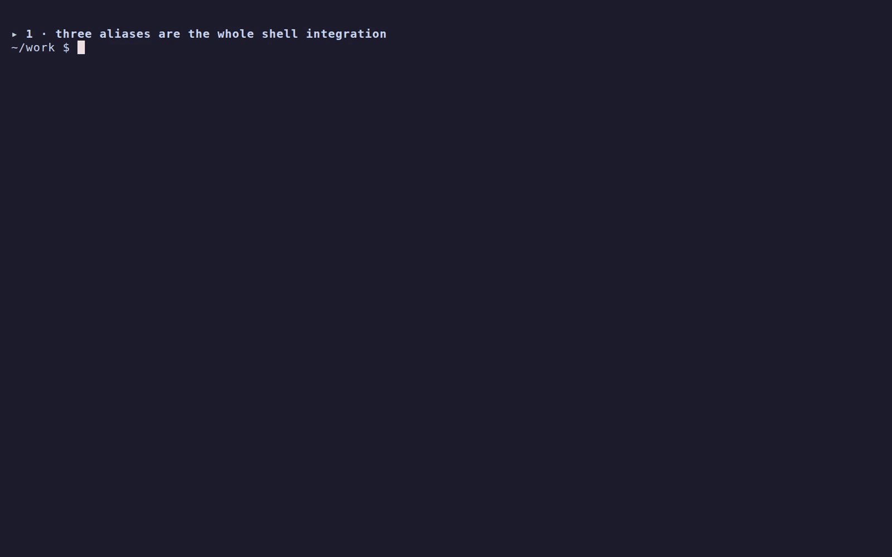
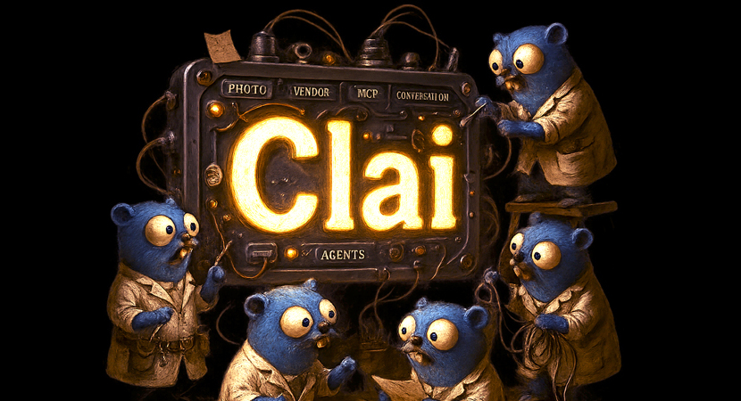

<div align="center">
  
  <h1>Command Line Artificial Intelligence</h1>
</div>


[](https://pkg.go.dev/github.com/baalimago/clai/pkg/agent)

Test coverage: 91.9% 😍👌

<hr>
<div align="center">
  <p><code>clai</code> (<i>/klaɪ/</i>, like "cli" in "<b>cli</b>mate") is a command line context-feeder for any ai task.</p>
</div>

## Get started

Installing:

```bash
curl -fsSL https://raw.githubusercontent.com/baalimago/clai/main/setup.sh | sh
```

You can also install via go:

```bash
go install github.com/baalimago/clai@latest
```

Or run it from the Nix flake without installing (flakes must be enabled):

```bash
nix run github:baalimago/clai
```

Then run:

```bash
clai | clai -query-summary query Please give a concise explanation of clai
```

`-query-summary` (`-qs`) prints a run summary after the answer: how long it took, the tokens, the cost, the tools it called and what the subagents it started spent, so a run that fans out still adds up to one bill. Set `"query-summary": true` in `textConfig.json` to always get it.

To keep only the answer, add `-reply-only` (`-ro`). The reply goes to stdout, while tool calls, tool output and reasoning go to stderr, so you can still watch the progress:

```bash
clai -reply-only -tools "rg,cat" query "Write release notes for the changes since the last tag" > NOTES.md
```

Most flags have a short form (`-qs`, `-ro`, `-prp`). The examples here use the long names so they read on their own.

Either run bare `clai` (or `clai <command> -h`) or look at the [examples](./examples.md) for how to use `clai`.
Prompt text starting with `-` is read as a flag, so pass it after `--`: `clai query -- -why does this fail`.
If you have time, you can also check out [this blogpost](https://lorentz.app/blog-item.html?id=clai) for a slightly more structured introduction on how to use Clai efficiently.

Install [Glow](https://github.com/charmbracelet/glow) for formatted markdown output when querying text responses.

## Run an agent from the Hub

A profile is a saved agent: a model, a prompt, its tools, MCP servers and skills.
Run one of your own by name with `-profile`, or someone else's straight from [clai.chat](https://www.clai.chat) or GitHub with `-profile-path`:

```bash
# an agent on the clai.chat Hub
clai -profile-path cchub:baalimago/sre-sync-prep@4 query
# a profile in a GitHub repo, or a github.com link copied from the browser
clai -profile-path gh:<owner>/<repo>/agents/reviewer.json@v1 query
clai -profile-path https://github.com/<owner>/<repo>/blob/main/agent.json query
```

A remote agent runs only once you trust it.
The trust prompt shows the model, the tools, the MCP servers and the skills it brings, and trust is kept per content hash, so a changed agent asks again.
Outside a terminal an untrusted target exits with status 3; append `#sha256=<hex>` to consent to exactly those bytes in CI or cron.
Fetched agents are cached, so a scheduled run makes no network call.
Share your own with `clai profiles publish <name>`, see `clai profiles -h` and [architecture/remote-targets.md](./architecture/remote-targets.md).

## Use clai as a Go library

Embed the agent loop in a Go program with `github.com/baalimago/clai/pkg/agent`:

```go
// Supports strucutred output via types
// Support all things the CLI does
review, err := agent.NewTyped[Review](agent.WithModel("gpt-5.2")).Query(ctx, chat)
```

The agent runs silent and returns typed errors. See [pkg/agent](https://pkg.go.dev/github.com/baalimago/clai/pkg/agent) for the option surface, the command ban list and the token stoploss, and [pkg/tools](https://pkg.go.dev/github.com/baalimago/clai/pkg/tools) for the tool catalog.

## Sync across machines (optional)

`clai cloud` keeps your config (profiles, MCP servers, shell contexts, skills, theme) and, if you like, your conversations in step between machines through a [clai.chat](https://www.clai.chat) account.
It works like git: nothing syncs on its own, and clai works the same without an account.

```bash
clai cloud login              # approve this machine in the browser
clai cloud status             # what you would commit, and what the server has
clai cloud pull               # bring down your account's changes
clai cloud commit -m "laptop" # upload yours
```

Config sync is free (up to 1 GB); conversations cost $1 per started GB a month and need a card on file.
A config file holding a literal key is never committed, a clash keeps your file and saves the other copy for `clai cloud resolve`, and `-r` prints JSON.
See `clai cloud -h` and [architecture/cloud.md](./architecture/cloud.md).

## Features

<div align="center">
  
  <p>Eleven acts in one shell session, each explained in <a href="./examples.md#showcase">examples</a>.</p>
</div>

- **[Shell context injection](./architecture/shell-context.md)** - Inject shell context into the system prompt via configurable templates.
- **[Seamless conversation import](./architecture/continue-from-claudex.md)** - Ran out of session? Continue in clai!
- **[Agent Skills](./architecture/skills.md)** - Import skills from custom global directories, or project-level `.agents/skills`.
- **[Profiles](./examples.md#profiles-workflow-presets)** - Pre-prompted profiles enabling customized workflows and agents, run locally or [from the Hub](#run-an-agent-from-the-hub).
- **[Loop until verified](./examples.md#loop-until-the-goal-is-verified)** - Add `-loop` to a query and clai iterates toward the goal, accepting completion only when `-check` passes.
- **[Structured output](./examples.md#blocking-structured-output)** - `-response-format` returns JSON instead of prose, from any vendor; Jev answers a fixed set of questions about the data you pipe in.
- **[MCP client support](./examples.md#mcp-tools-external-tool-servers)** - Add any MCP server you'd like by pasting their configuration.
- **[Images, both ways](./architecture/images.md)** - Attach images with `-image`, a glob or stdin to any model, and get images back through the `generate_image` tool, or from an image-output model.
- **[Sync, git-style](./architecture/cloud.md)** - `clai cloud pull` and `commit` carry your config and conversations between machines, only when you ask.
- **[Reply only](./examples.md#keep-only-the-reply-write-it-to-a-file-watch-the-progress)** - `-reply-only` keeps stdout for the answer and draws the progress on stderr.
- **Unix-like** - Clai follows the [unix philosophy](https://en.wikipedia.org/wiki/Unix_philosophy) and works with data piped in and out.

All of these features are easily combined and tweaked, empowering users to accomplish very diverse use cases.
See [examples](./examples.md) for additional info.

## Supported vendors

| Vendor      | Environment Variable | Models                                                                                                                                                             |
| ----------- | -------------------- | ------------------------------------------------------------------------------------------------------------------------------------------------------------------ |
| Jev         | `TYPESAFE_API_KEY`   | [System One](https://docs.typesafe.ai/api) evaluation, model `jev-latest`, questions from `-response-format`                                                                    |
| OpenRouter  | `OPENROUTER_API_KEY` | [Text models](https://openrouter.ai/models), [image models](https://openrouter.ai/models?output_modalities=image), use prefix `or:`                              |
| Ollama      | `OLLAMA_API_KEY`     | Use format `ollama:` (defaults to llama3), server defaults to localhost:11434                                                                                      |
| HuggingFace | `HF_API_KEY`         | [Text models](https://huggingface.co/docs/inference-endpoints/chat-completions), use prefix `hf:`                                                                  |
| Mistral     | `MISTRAL_API_KEY`    | [Text models](https://docs.mistral.ai/getting-started/models/)                                                                                                     |
| OpenAI      | `OPENAI_API_KEY`     | [Text models](https://platform.openai.com/docs/models), [photo models](https://platform.openai.com/docs/models/dall-e)                                             |
| DeepSeek    | `DEEPSEEK_API_KEY`   | [Text models](https://api-docs.deepseek.com/quick_start/pricing), key is optional, no prefix (defaults to `deepseek-chat`)                                         |
| Berget AI   | `BERGET_API_KEY`     | [Text models](https://berget.ai/models), use prefix `berget:`                                                                                                      |
| Gemini      | `GEMINI_API_KEY`     | [Text models](https://ai.google.dev/gemini-api/docs/models), [photo models](https://ai.google.dev/gemini-api/docs/image-generation#image_generation_text-to-image) |
| xAi         | `XAI_API_KEY`        | [Text models](https://docs.x.ai/docs/models)                                                                                                                       |
| Inception   | `INCEPTION_API_KEY`  | [Text models](https://platform.inceptionlabs.ai/docs#models)                                                                                                       |
| Anthropic   | `ANTHROPIC_API_KEY`  | [Text models](https://platform.claude.com/docs/en/about-claude/models/overview)                                                                                    |

<div align="center">
  
</div>
