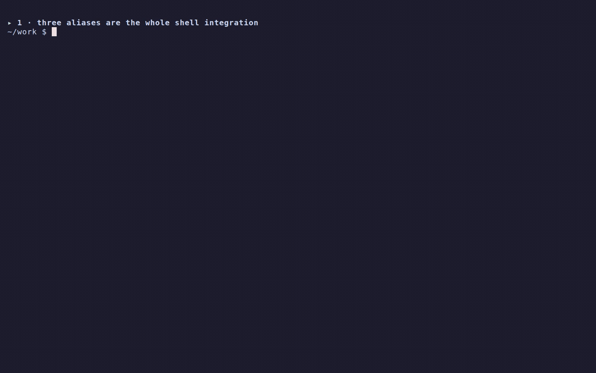
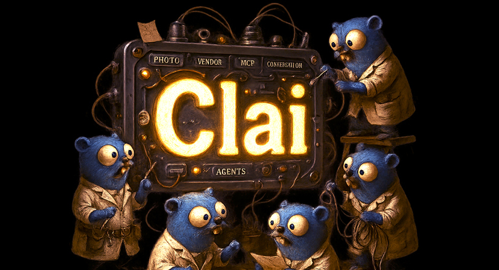

[](https://pkg.go.dev/github.com/baalimago/clai/pkg/agent)

Test coverage: 92.4% 😍👌

<div align="center">
  <a  href="https://www.clai.chat">
  
  </a>
  <h2>&gt;|✦ Command Line Artificial Intelligence</h2>
  <p><code>clai</code> (<i>/klaɪ/</i>, like "cli" in "<b>cli</b>mate") is a unix-like command line agentic harness with batteries hosted online.</p>
</div>

### Get started

Installing:

```bash
curl -fsSL https://raw.githubusercontent.com/baalimago/clai/main/setup.sh | sh
```

You can also install via go:

```bash
go install github.com/baalimago/clai@latest
```

Or run it from the Nix flake without installing (flakes must be enabled):

```bash
nix run github:baalimago/clai
```

Then run:

```bash
clai | clai query Please give a concise explanation of clai
```

Install [Glow](https://github.com/charmbracelet/glow) for formatted markdown output when querying text responses.

`man clai` documents every command. setup.sh installs the page, and the first run of a new release in a terminal installs or updates it; `clai man install` does it on demand and `CLAI_MANPAGE=off` turns the automatic install off.

See <a href="https://www.clai.chat">clai.chat</a> for details on usecase of all the features. Here's a brief summary:

<div align="center">
  
  <p>Eleven acts in one shell session, each explained in <a href="./examples.md#showcase">examples</a>.</p>
</div>


## Features

- **[Shell context injection](./architecture/shell-context.md)** - Inject shell context into the system prompt via configurable templates.
- **[Seamless conversation import](./architecture/continue-from-claudex.md)** - Ran out of session? Continue in clai!
- **[Agent Skills](./architecture/skills.md)** - Import skills from custom global directories, or project-level `.agents/skills`.
- **[Profiles](./examples.md#profiles-workflow-presets)** - Pre-prompted profiles enabling customized workflows and agents, run locally or [from the Hub](#run-an-agent-from-the-hub).
- **[Model fallback](./architecture/model-aliases.md)** - Name a verb (`strong`, `fast`, `cheap`) instead of a model: each machine resolves it to its own ordered list and the run tries them in turn, so a shared profile runs anywhere.
- **[Loop until verified](./examples.md#loop-until-the-goal-is-verified)** - Add `-loop` to a query and clai iterates toward the goal, accepting completion only when `-check` passes.
- **[Structured output](./examples.md#blocking-structured-output)** - `-response-format` returns JSON instead of prose, from any vendor; Jev answers a fixed set of questions about the data you pipe in.
- **[MCP client support](./examples.md#mcp-tools-external-tool-servers)** - Add any MCP server you'd like by pasting their configuration.
- **[Images, both ways](./architecture/images.md)** - Attach images with `-image`, a glob or stdin to any model, and get images back through the `generate_image` tool, or from an image-output model.
- **[Sync, git-style](./architecture/cloud.md)** - `clai cloud pull` and `commit` carry your config and conversations between machines, only when you ask.
- **[Reply only](./examples.md#keep-only-the-reply-write-it-to-a-file-watch-the-progress)** - `-reply-only` keeps stdout for the answer and draws the progress on stderr.
- **Unix-like** - Clai follows the [unix philosophy](https://en.wikipedia.org/wiki/Unix_philosophy) and works with data piped in and out.

All of these features are easily combined and tweaked, empowering users to accomplish very diverse use cases.
See [examples](./examples.md) for additional info and [clai.chat](https://www.clai.chat/docs/guides/queries-and-pipes/) for in-depth guides.

## Featured supported vendors

| Vendor      | Environment Variable | Models                                                                                                                                                             |
| ----------- | -------------------- | ------------------------------------------------------------------------------------------------------------------------------------------------------------------ |
| Jev         | `TYPESAFE_API_KEY`   | [System One](https://docs.typesafe.ai/api) evaluation, model `jev-latest`, questions from `-response-format`                                                                    |
| OpenRouter  | `OPENROUTER_API_KEY` | [Text models](https://openrouter.ai/models), [image models](https://openrouter.ai/models?output_modalities=image), use prefix `or:`                              |
| Ollama      | `OLLAMA_API_KEY`     | Use format `ollama:` (defaults to llama3), server defaults to localhost:11434                                                                                      |
| Mistral     | `MISTRAL_API_KEY`    | [Text models](https://docs.mistral.ai/getting-started/models/)                                                                                                     |
| OpenAI      | `OPENAI_API_KEY`     | [Text models](https://platform.openai.com/docs/models), [photo models](https://platform.openai.com/docs/models/dall-e)                                             |
| DeepSeek    | `DEEPSEEK_API_KEY`   | [Text models](https://api-docs.deepseek.com/quick_start/pricing), key is optional, no prefix (defaults to `deepseek-flash`)                                         |
| Gemini      | `GEMINI_API_KEY`     | [Text models](https://ai.google.dev/gemini-api/docs/models), [photo models](https://ai.google.dev/gemini-api/docs/image-generation#image_generation_text-to-image) |
| Anthropic   | `ANTHROPIC_API_KEY`  | [Text models](https://platform.claude.com/docs/en/about-claude/models/overview)                                                                                    |


<sub>Moved but never forgotten:</sub>
<div align="center">
  
</div>
